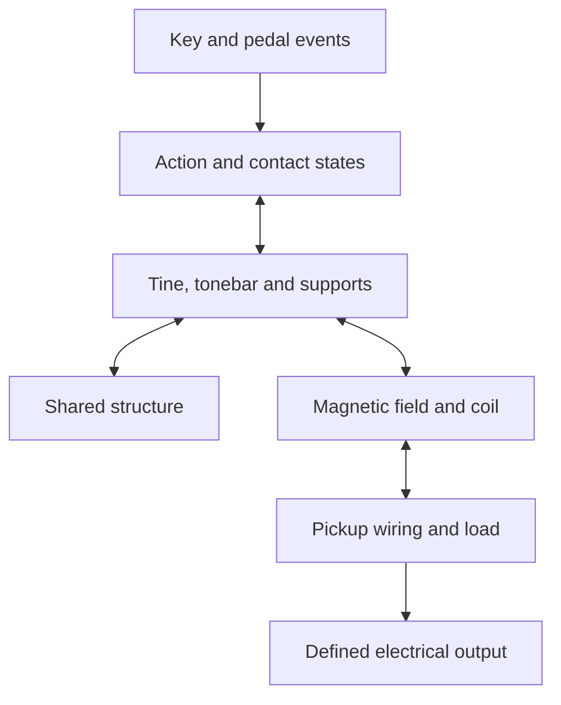

# Physical-model architecture

## Scope and current implementation boundary

The product goal is a sample-free physical model of a **Fender Rhodes Mark I**.
The first scientific target is one identified **73-key Stage specimen**, beginning
at its harp terminals under a specified electrical load and then extending to the
Stage output jack, controls, cable, and receiving input. The specimen has not yet
been selected or measured. No current parameter set can therefore claim to
reproduce a particular instrument, manufacturing year, or circuit revision.

The initial C++ research kernel exercises analytic modal motion, persistent
retrigger state, a polynomial flux-linkage derivative, and a simplified passive
pickup network. Its constants are synthetic. Impulse excitation and switched
loss are development surrogates, not completed hammer and damper models. This
architecture describes the target system; `project/state.json` and
[PROJECT_STATE.md](PROJECT_STATE.md) distinguish implemented work from future work.

The source basis is the user-supplied [research brief](research/USER_RESEARCH.txt),
particularly sections 1–8 and 12. External references listed there are research
leads; preserving a citation does not mean the repository has independently
verified its claims or obtained permission to reuse its source code or figures.

## Layers and ownership

| Layer | Responsibility | Allowed dependencies | Evidence required before promotion |
|---|---|---|---|
| Acquisition and provenance | Specimen identity, geometry, instrument settings, calibration, raw records, uncertainty | Measurement tools and immutable records | Traceable acquisition manifest and repeatability study |
| Offline physical reference | Coupled mechanics, electromagnetic energy, and connected electrical network | Numerical and identification tools with recorded versions | Convergence, energy, analytic limits, independent physical observations |
| Model asset compiler | Reduce reference models, fit smooth maps, export bounded parameter assets | Offline reference and approved datasets | Asset manifest, source hashes, domain bounds, reduction error |
| Runtime core | Fixed-storage states, deterministic sample/event processing, bounded numerical work | C++ standard library and reviewed small dependencies | Reference comparison, numerical limits, callback stress measurements |
| Host adapters | MIDI/event translation, audio I/O, plug-in formats, state persistence | Runtime public API | Timing, compatibility, lifecycle, state migration tests |
| Presentation and tools | UI, diagnostics, offline render and measurement comparison | Adapter or public core interface | Correct units, meaningful controls, no unsupported realism claims |

Offline tooling may allocate, run expensive solvers, and use detailed geometry.
The audio callback may not perform file I/O, logging, locking, dynamic allocation,
asset parsing, or unbounded retries. Setup-time validation produces an immutable
configuration. The processing interface consumes bounded event lists and writes
preallocated buffers. An offline renderer is a test tool, not a real-time
performance certificate or a released plug-in.

## Coupled system

An arrow crossing a physical port carries explicitly oriented effort and flow
variables. Mechanical ports use force in newtons and velocity in metres per
second; electrical ports use voltage in volts and current in amperes. A diagram
is not a netlist: actual node names, winding polarities, group membership, and
measurement reference planes must come from the selected specimen.

### Per-key state and physical identity

Maintain one persistent state for every physical key. The initial target has 73
keys; the specimen record must establish the physical-to-MIDI mapping rather than
inferring it from a host preset. A key state eventually contains:

- Hammer position, velocity, effective mass, contact compression, and contact mode.
- Retained tine/tonebar modal coordinates and velocities, with consistent mode normalization.
- Damper position/velocity or a validated reduced contact state, including individual clearance.
- Pickup geometry and magnetic/electrical state references.
- Key-actuation state, release timing, and calibration references.

A repeated strike launches a new hammer event against the existing resonator
motion. It must not replace displacement, velocity, or phase. Note-off changes
actuation and damper contact; it does not reset a resonator. Pedal position changes
the common linkage while preserving per-key offsets. Panic/reset is a separate,
explicit host operation and is not a musical release model.

Mechanical activity and electrical membership are separate. A stationary pickup
still has impedance and remains in the connected circuit. Sleeping a mechanical
state requires an error bound, a wake rule, and a treatment of coupling; it must
not silently delete an electrical branch.

### Mechanical reference

Use the following equation as a bookkeeping contract, not as a claim that all
terms are currently implemented:

\[
M\ddot q+C\dot q+Kq+g(q,\dot q)
=b_h F_h+b_d F_d+f_{\mathrm{mag}}+f_{\mathrm{harp}}.
\]

Choose the coordinate origin at the assembled resting equilibrium. Record whether
measured modal properties include the pickup, its load, mounting preload, and
damper contact. Separating these conditions prevents adding a magnetic or
boundary contribution twice. Every mode records mass/normalization, frequency,
loss, hammer participation, damper participation, pickup observation, support
participation, and validity range. Inharmonic modes are permitted; output
harmonics are not automatically independent mechanical modes.

The tuning spring, tonebar block, screws, grommets, and supports enter through
measured mass distribution, compliance, loss, and preload. A part is represented
at the level needed to reproduce its observable effect. Creating an oscillator
for every screw without identifying that effect would add parameters without
establishing accuracy.

A candidate unilateral hammer law is

\[
F_h=\begin{cases}
\max(0,k\delta^p+c\delta^p\dot\delta),&\delta>0,\\
0,&\delta\leq 0.
\end{cases}
\]

The reference must retain finite hammer mass, equal-and-opposite reaction,
separation, possible recontact, and dissipation accounting. This expression is a
candidate to identify, not a measured constitutive law. Fit force/kinematics across
held-out impact speeds. MIDI velocity requires a documented launch calibration;
an arbitrary output gain is not an identified action model. Damper contact needs
its own geometry and constitutive law. A changed decay coefficient remains an
explicit surrogate until validated against the actual contact response.

### Magnetic conversion and reciprocity

With a chosen polarity, the open-circuit motional source is

\[
e_m=-\nabla_q\lambda_{\mathrm{pm}}(q)\cdot\dot q.
\]

Flux linkage is measured in weber-turns; its numerical SI dimension is volt-second.
It already includes turns. A map expressed as flux per turn must be multiplied by
the winding turns once when converted to linkage, never twice.

Reconstruct the local physical motion from all relevant modes **before** evaluating
the nonlinear field map. For example, the square of a sum contains cross terms;
separate per-mode nonlinearities erase the intermodulation generated by a shared
pickup. A tip-only scalar map is an approximation whose omission of orientation
and distributed deformation requires validation.

The detailed reference must use compatible magnetic energy/co-energy relations
for current-linked flux and force. Under one passive terminal convention,
`v = R i + d(lambda(q, i))/dt`; the motional Thevenin-source sign depends on the
recorded winding orientation. Derive mechanical reaction from the same energy
model and include permanent-magnet attraction at zero current. A voltage-fitted
map alone does not identify that static force. High receiving-input impedance
does not prove that internal currents between parallel pickup branches vanish.

Smooth interpolation must provide consistent derivatives, a declared domain, and
a defined out-of-domain error. A silent clamp or extrapolation cannot become a
physical law. Any omitted reciprocal force in the runtime model needs a measured
or reference-derived error envelope across gap, strike strength, and load.

### Pickup network and passive Stage circuit

Each pickup has a source, winding resistance, identified inductance, relevant
parasitics, polarity, and node connections. In the linear frequency-domain limit,
a parallel group satisfies

\[
Z_g=\left(\sum_i 1/Z_i\right)^{-1},\qquad
E_g=Z_g\sum_i e_i/Z_i.
\]

For equal branches this is a source average and a divided impedance. Silent
branches still load active sources. The research brief gives a later 73-key wiring
arrangement as a documentary lead; it is not a verified universal topology. The
initial equal-resistance network is a synthetic analytic test case and does not
replace impedance sweeps or specimen continuity checks.

The target Stage circuit includes measured control topology/tapers, wiper
behavior where material, cable capacitance, and receiver impedance. Electrical
loading begins in the one-note milestone. An EQ placed after an arbitrary sum of
voices is not presumed equivalent to that circuit.

### Future powered circuits and acoustics

Keep Peterson, Janus/Haigler, and other identified revisions in separate profiles.
Do not combine an attractive oscillator from one revision with a power stage from
another and label the result a historical model. Every circuit requires its own
verified graph, component inventory, corrections, device laws, supply conditions,
and operating point.

Modified nodal analysis is the preferred detailed-reference representation. Wave
digital or reduced state-space forms are candidates for runtime deployment when
they preserve the identified port behavior. Shared nonlinear stages process the
combined input; one independently distorted preamp per note changes chord
interactions. Optical states, lamp/LED drive, thermal response, power rails, and
speaker back EMF must retain relevant history and coupling.

The baseline contains no speaker, room, or microphone target. If an acoustic
profile is later approved, define its electrical and spatial boundaries first.
Terminal voltage/current, driver motion, cabinet radiation, and microphone paths
need separate evidence. The strict project baseline uses no recorded-note
playback. Any future impulse-response asset requires an explicit scope decision,
source rights, and a declaration of its linear operating range; it cannot replace
level-dependent loudspeaker physics.

## Component and parameter contracts

Each physical component or reduced parameter must have the following traceability.
These are required record semantics, independent of the eventual serialization.

| Field | Meaning |
|---|---|
| Stable ID and revision | Unique part, key, geometry, or reduced-model identity |
| Location and connectivity | Physical assembly or electrical nodes, including orientation |
| Quantity, value, SI unit | A known value or explicit unknown; zero is not a missing value |
| Provenance class | Documentary, measured, fitted, assumed, or synthetic |
| Source locator and hash | Specific source page/record/dataset and immutable content hash when available |
| Uncertainty | Measurement uncertainty or stated model/assumption range and method |
| Conditions | Temperature, load, controls, geometry, actuation, specimen revision |
| Model law and version | Constitutive law, solver, fitting procedure, source commit |
| Validity domain | Range tested, excluded conditions, out-of-range behavior |
| Evidence linkage | Tests and held-out observations that support the claimed use |

Never copy a typical component value into a measured field. Never treat a fitted
parameter as independently measured. Keep correlated parameters and uncertainty
visible; good output fit alone may not uniquely identify them.

## Numerical and runtime contracts

The reference solver must find a consistent operating point and report residuals,
iteration counts, failure conditions, energy terms, and convergence as its step
size decreases. Runtime work must have a fixed upper bound and documented failure
behavior. Stability, passivity, waveform accuracy, and timing are separate claims.
A stable method can still alter decay, phase, or tuning.

Nonlinear magnetic conversion and circuits require antialiasing inside the
relevant coupled path. Choose internal rates and filters through convergence
studies, including hard strikes and high notes. A final low-pass filter does not
undo aliasing already folded into the audible band. No single oversampling factor
is promised before measurement. Slow thermal/optical updates require their own
error study and state-consistent interpolation.

Events must carry integer sample offsets and deterministic tie-breaking rules.
The same timestamped sequence must behave consistently across buffer sizes.
Changes to sample rate, model configuration, or host state require explicit
prepare/reset/migration semantics. No configuration replacement may leave partly
updated states in the callback.

Version exported assets and serialized states independently from user-facing
release numbers. Reproduction records include source commit, compiler/toolchain,
platform, sample rate, block size, model/dataset hashes, and random seed if any.
Cross-platform comparisons should use justified numerical tolerances rather than
assuming bitwise equality across every compiler and math library.

## Development map

See [ROADMAP.md](ROADMAP.md) for task exit criteria,
[MEASUREMENT_PLAN.md](MEASUREMENT_PLAN.md) for acquisition and identification,
[VALIDATION.md](VALIDATION.md) for evidence levels, and the
[ADRs](adr/README.md) for the initial decisions. All four documents constrain
claims; none can mark a task complete without supporting implementation and
recorded evidence.
