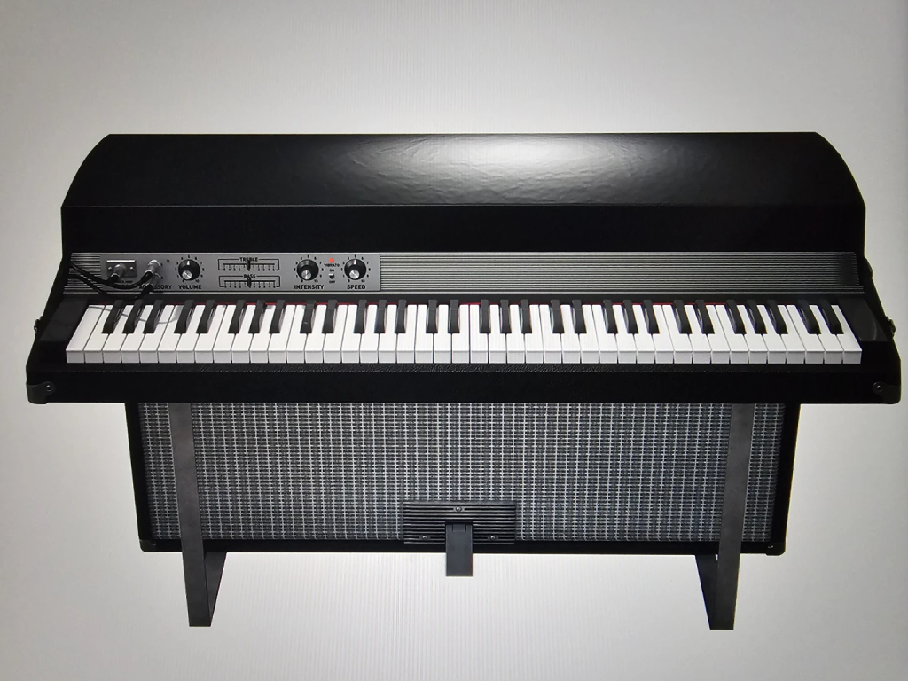

# Photo editor wave 1 checkpoint — 24 November 2026

The complete Linux Release build passed **502/502 registered CTests**, including all three SDK validators, loaded module/editor contracts, state/automation/MIDI regression tests, and resource validation. A later resource-only check passed after adding the upstream Expat notice. The [structured record](photo-editor-wave1-20261124.json) binds this working-tree observation to source hashes. It is a scoped checkpoint, not final HOST-004 acceptance.

The direct plugin's actual native editor attached in the pinned official SDK editorhost at 1024 × 768. On a fresh isolated X11 display, the sample host requires `_XEMBED_INFO` to exist before window creation; the test harness seeded it. The unmodified host then stayed alive through capture. The earlier failed-window teardown is recorded in worker W1-019's report; it is not an observed plugin-attachment crash.

This is a capture of the rendered native plugin, not the original image or a browser mockup. The bundled PNG separately passed exact decoded RGB and ICC-profile comparison against the unchanged uploaded WebP. At this checkpoint the screenshot was visually inspected; a full-resolution pixel comparison and accepted edit-gesture harness remain for later waves.

The SDK-only loaded editor fixture passed 3,855 assertions across nine controllers and 24 created views. The audition processor fixture passed 6,234 checks and 2,304 exact reference frames per model, with no observed ordinary C++ allocations in its 35 measured callbacks per model. These fixtures have explicit limits recorded in the [worker reports](../agents/photo-editor-20261124/README.md).

No Windows/macOS result, real DAW session, audio-device deadline, physical calibration, or final product completion is implied by this checkpoint. The synthetic tone/modulation design and legacy neutral-path compatibility are separate from matching the supplied photograph.
